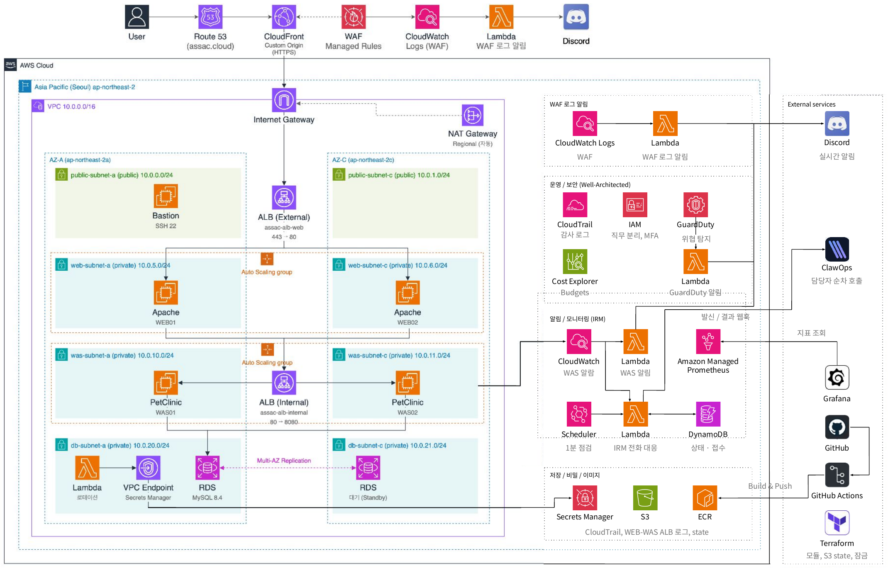

<div align="center">



<br/>

<h1>PetClinic 3-Tier Architecture</h1>

<p>Web · WAS · DB 3계층으로 분리한 AWS 인프라를 Terraform으로 정의했습니다.</p>

<p>
  
  
  
  
  
</p>

<p><b>베스핀 글로벌 AWS 클라우드 과정 · ASSAC팀 프로젝트</b></p>

</div>

---

## 소개

Spring PetClinic을 Web, WAS, DB 3계층으로 나누어 AWS에 구축했습니다. 각 계층은 서브넷과 보안 그룹으로 분리했고, 앞단에는 CloudFront와 WAF를 두었습니다.

콘솔에서 먼저 구축한 리소스를 `import`로 가져와 Terraform 코드로 전환했습니다. 상태 파일은 S3 백엔드에 저장하고 `use_lockfile`로 동시 실행을 막습니다.

## 시연 영상

[Google Drive에서 시연 영상 보기](https://drive.google.com/drive/folders/1AZxZ8EKNrwyWot7zGbm50wZDtMJ4wOyO?usp=sharing)

## 3-Tier 구성

| 계층 | AWS 구성 | 역할 |
|---|---|---|
| Edge | CloudFront · WAF | HTTPS 종료, 공통·SQLi 룰, Rate Limit |
| Web Tier | 외부 ALB · Apache (Public/Web 서브넷) | 요청 수신, 정적 응답, WAS로 프록시 |
| WAS Tier | 내부 ALB · Spring PetClinic (Docker, Auto Scaling) | 애플리케이션 처리, CPU 기준 확장 |
| DB Tier | RDS MySQL Multi-AZ · Secrets Manager (DB 서브넷) | 데이터 저장, 자격 증명 자동 교체 |

각 계층은 앞 계층의 보안 그룹에서 오는 트래픽만 허용합니다.

## 요청 흐름

1. 사용자의 요청이 CloudFront에서 WAF 검사를 거칩니다.
2. 외부 ALB와 Apache(Web)가 받아 내부 ALB로 전달합니다.
3. 내부 ALB가 Auto Scaling Group의 PetClinic 컨테이너(WAS)로 분배합니다.
4. WAS가 Secrets Manager의 자격 증명으로 RDS(DB)에 연결합니다.

## 배포와 운영

- GitHub Actions가 Docker 이미지를 빌드해 ECR에 올립니다.
- Auto Scaling Group의 Instance Refresh가 새 인스턴스로 점진 교체합니다.
- 장애와 보안 이벤트는 CloudWatch, GuardDuty, Lambda를 거쳐 Discord로 알립니다.

## 디렉터리

| 경로 | 계층 | 내용 |
|---|---|---|
| `modules/network` | 공통 | VPC, 서브넷, 라우트 테이블, IGW, NAT Gateway |
| `modules/security-group` | 공통 | ALB, WAS, DB, Bastion, VPC Endpoint 보안 그룹 |
| `modules/edge` | Edge | CloudFront 배포, WAF 연결 |
| `modules/compute` | Web · WAS | ALB, 대상 그룹, 시작 템플릿, Auto Scaling Group |
| `modules/rds` | DB | MySQL Multi-AZ, DB 서브넷 그룹, Secrets Manager 연동 |
| `imports_*.tf` | 공통 | 기존 리소스를 상태로 가져오는 import 블록 |

## 사용 방법

```bash
terraform init
terraform plan
```

> 이 저장소는 기록용입니다. 대상 AWS 리소스는 이미 삭제되어 있어, `apply`를 실행하면 리소스가 새로 만들어지고 비용이 발생합니다.# assac-3tier-terraform
